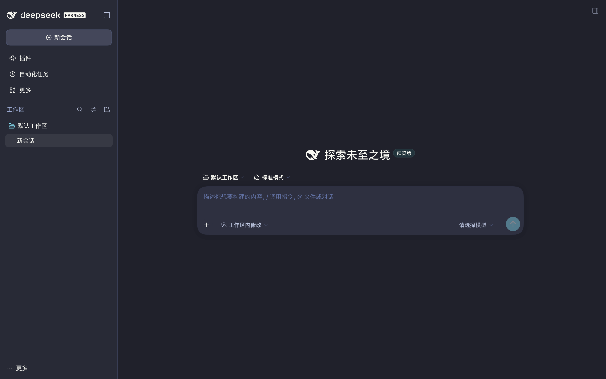
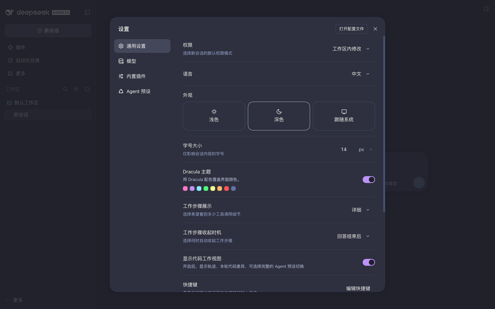

# Dracula for [DeepSeek Harness](https://github.com/deepseek-ai/deepseek-harness)

> A dark theme for [DeepSeek Harness](https://github.com/deepseek-ai/deepseek-harness) — sidebar, chat, composer, menus and settings in Dracula colors.



把 [Dracula](https://draculatheme.com/) 配色搬进 DeepSeek Harness：整站（侧栏、对话区、输入框、菜单、设置页、代码高亮）换成 `#20212B` / `#282A36` / `#44475A` 这套配色，取值对齐 [官方 DeepSeek 移植版](https://draculatheme.com/deepseek)。



## 特点 / Highlights

- **整站换肤**：101 个 `--dsw-alias-*`、11 个 `--dsw-specific-*`（侧栏 / 输入框 / 气泡 / 菜单这类模块专属层）、11 个 `--shiki-token-*`（代码高亮）、两条 think 渐变与选区色，全部按 Dracula 取值重述。
- **首帧就是 Dracula**：宿主半随 HTML 注入 `<style>` 与一段首帧脚本，页面加载时不会先闪一下内置深色。
- **不抢浅色**：只在应用处于深色外观时生效；用户切到「浅色」，主题自动让位。
- **零依赖**：宿主半只用 Node 内建模块，不引入任何 `@deepseek-ai/*` 包，不需要构建。

## 安装 / Install

### 插件市场（收录后）

在 DeepSeek Harness 的「插件」页搜索 **dsh-theme-dracula**，安装后重启应用。

### 本地安装

```bash
git clone https://github.com/PuerJJJ/dsh-theme-dracula
cd dsh-theme-dracula
node scripts/install.mjs --profile desktop           # dry-run：先看清要改什么
node scripts/install.mjs --profile desktop --apply   # 建软链并登记到 dsh.profile.bundles
```

重启 DeepSeek Harness，然后打开 **设置 → 通用设置**，找到「Dracula 主题」并打开开关。

脚本只在 `$DSH_HOME/profiles/<profile>/node_modules/` 下建一个软链，并把包名追加进该 profile 的 `dsh.profile.bundles`；写入前会备份 `package.json.bak-dracula`，不改 `dependencies`、不动 `pnpm-lock.yaml`（bundle 只需能按包名解析，与内置 bundle 的加载方式一致）。

### 卸载 / Uninstall

```bash
node scripts/install.mjs --profile desktop --uninstall --apply
```

或手动删除 `node_modules/dsh-theme-dracula` 软链、把包名从 `dsh.profile.bundles` 移除，然后重启。

## 工作原理 / How it works

插件分两半，都是手写零依赖实现：

**宿主半 `lib/index.js`** — 订阅 `webserver/index-inject`，向每次页面渲染注入一个 `<style>`（到 `<head>`）和一段内联 `<script>`（到 `<body>` 末尾）：

- 样式写在 `:root:root body[data-dsh-dracula]{…}` 下。重复伪类把特异度提到 (0,3,1)，压过设计平台运行时 append 的 `body`、`body[data-ds-dark-theme]`、`html[data-platform=darwin] body` 规则，不依赖注入顺序。
- 覆盖四层变量：`--dsw-alias-*`、`--dsw-specific-*`（不改这层侧栏不跟着变色）、`--shiki-token-*`（DSH 的代码高亮走 `theme: "css-variables"`，改变量即可）、以及 think/select 渐变与 `--dsh-boot-bg`。
- 首帧脚本在任何客户端 bundle 之前执行：读 `localStorage` 开关 → 挂到 `globalThis.__DSH_DRACULA__` 给客户端半读 → 按 `body[data-ds-dark-theme]` 决定是否给 `<body>` 加 `data-dsh-dracula` → `MutationObserver` 跟随后续外观切换。

**客户端半 `lib/client.js`** — 一个 `window.__ModuleLoader__.load({ id: "dsh-theme-dracula", … })` bundle，`inject = ["theme", "slots", "locale"]`：

- 从 `ctx.theme.getTheme().active.colorScheme` 取当前外观，`ctx.on("theme/change", …)` 跟随变化；
- 用 `ctx.slots.register` 往 `settings.general.item` 槽位注册一行设置（order 12），左侧标题 / 描述 / 八色圆点，右侧是 primitives 的 `Switch`；
- 开关写回 `localStorage`，`paint()` 只做 `document.body.toggleAttribute("data-dsh-dracula", enabled && dark)`。

文案走 `ctx.locale.register("dsh-theme-dracula", { zh, en })`。

> 没有注册成 ui-theme 的第三方主题：ui-theme 只持久化 `light | dark | system`，任何一次字体或外观设置变更都会把第三方 id 顶回内置值，主题会静默消失。CSS 皮肤层跟随外观状态，行为更稳。

## 调色板 / Palette

| 用途 | 变量 | 取值 |
| --- | --- | --- |
| 页面底色 | `--dsw-alias-bg-base` | `#20212b` |
| 侧栏 / 代码块 | `--dsw-specific-sidebar-fill`、`--dsw-alias-bg-layer-1`、`--dsw-alias-markdown-code-block` | `#282a36` |
| 卡片 / 输入框 / 悬浮 | `--dsw-alias-bg-layer-2`、`--dsw-specific-input-major` | `#2e3040` |
| 选中 / 抬升 | `--dsw-alias-bg-layer-3`、`--dsw-specific-sidebar-nav-item-active` | `#44475a` |
| 主文字 | `--dsw-alias-label-primary` | `#f8f8f2` |
| 次级 / 三级 / 注释 | `--dsw-alias-label-secondary`、`-tertiary`、`-caption` | `#bbc4de` / `#9ba9d0` / `#6272a4` |
| 强调 / 主按钮 | `--dsw-alias-brand-primary`、`--dsw-alias-button-primary-fill` | `#bd93f9` |
| 链接 / 焦点 | `--dsw-alias-link`、`--dsw-alias-state-business-primary` | `#8be9fd` |
| 成功 / 警告 / 错误 | `--dsw-alias-state-success-primary` 等 | `#50fa7b` / `#ffb86c` / `#ff5555` |
| 代码高亮 | `--shiki-token-keyword`、`-string`、`-comment`、`-function`、`-parameter` | `#ff79c6` / `#f1fa8c` / `#6272a4` / `#50fa7b` / `#8be9fd` |

## 和 draculatheme.com/deepseek 的关系 / Relation to the official port

[draculatheme.com/deepseek](https://draculatheme.com/deepseek) 是给 **chat.deepseek.com** 网页版的 Stylus 用户样式，靠覆盖 `--dsw-static-*` 与 Prism 类名生效，只在浏览器里那个域名下有用。这里是同一套配色在 **DeepSeek Harness 设计 token** 上的移植：DSH 的 dark alias 里有 32 个是字面值，侧栏 / 输入框 / 菜单走独立的 `--dsw-specific-*` 层，代码高亮走 `--shiki-token-*`，只搬 static 会大面积漏色，所以这版把三层都重述了。

## 自检 / Self-check

```bash
node scripts/verify.mjs
# 可选：对比内置 alias token 表，确认 101 个 token 一个不漏
node scripts/verify.mjs --audit /tmp/dsh-probe/alias-table.txt
```

校验内容：宿主注入行、CSS 大括号配平、首帧脚本可解析、客户端半在 stub 环境下的开关 / 属性联动、调色板完整性。

## Team

Maintained by [PuerJJJ](https://github.com/PuerJJJ).

## Community

- [X (Twitter)](https://x.com/draculatheme) and [Instagram](https://instagram.com/draculatheme)
- [Discord](https://draculatheme.com/discord-invite)
- [GitHub Discussions](https://github.com/dracula/dracula-theme/discussions)

## License

[MIT License](./LICENSE)
